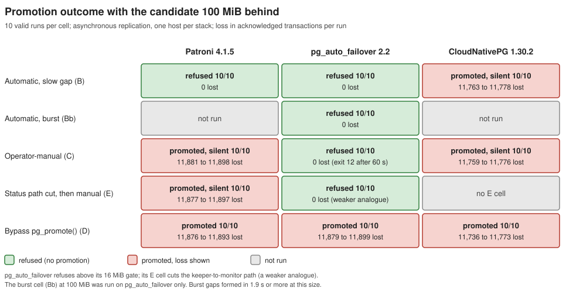

A lag limit reads like a promise. Patroni's `maximum_lag_on_failover` is described as the maximum bytes a follower may lag to take part in leader election, and its docs say the data you can lose in asynchronous mode is controlled by it. It is natural to read that as "failover will not lose more than this."

I wanted to know what that promise covers in practice. So I put a replica 10 MiB and 100 MiB behind, killed the primary, and counted what each stack did with three of them: Patroni 4.1.5, pg_auto_failover 2.2 and CloudNativePG 1.30.2.

## How the gap was built

I stalled WAL shipping to the candidate replica while four writers kept committing to the primary. On Patroni and pg_auto_failover a small TCP proxy sits on the replication path and stops reading. On CloudNativePG, iptables rules drop replica-to-primary traffic. The replica's agent stays alive, so no stack sees a dead replica.

Every run checks the gap against the primary's and the candidate's LSNs. A run is valid only if the verified gap is within 25% of the target. After the primary is killed, I recompute loss from stored lists: the ids the writers saw acknowledged, and the ids that exist on the promoted node. Loss is the acknowledged ids that are missing. 300 valid runs, 10 per cell.

## Patroni: the check is only as fresh as the leader's last write

At a slowly formed gap (about 15 s), Patroni's automatic path refused 20 of 20 runs, and nothing was lost. That is the limit working.

Two things differ. When an operator runs `patronictl failover` with a named candidate and the leader is gone, my reading of the 4.1.5 source and the runs agree: no lag check applies. It promoted in 40 of 40 runs across the manual and coordination-cut scenarios and lost the whole gap, 11,881 to 11,898 acknowledged transactions at 100 MiB. (I scripted the command with `--force`, so I did not exercise the confirmation prompt.)

The number that surprised me came from a burst test with unthrottled writers. The automatic check compares the candidate with the leader position last stored in the DCS. In those runs that stored position was 24 to 287 MiB behind the candidate's own, so the computed lag was negative. The automatic path promoted silently in 10 of 10 runs and lost 1,160 to 1,307 transactions. The docs do say the primary's position "is not sampled in real time". This puts a size on it.

## pg_auto_failover: one real gate, and the log that names another setting

pg_auto_failover has one gate, 16 MiB, applied to automatic and operator promotion alike. At 100 MiB it refused 30 of 30 runs across those paths. At 10 MiB, below the gate, it promoted silently every time and lost the whole gap (1,188 transactions).

What stood out is the refusal itself. `pg_autoctl perform promotion` waits 60 s and exits with status 12 and no lag text. The reason sits in the monitor log, repeated 240 to 251 times in one run, and it names `pgautofailover.enable_sync_wal_log_threshold` while the comparison actually uses `promote_wal_log_threshold`. An operator who reads the message and changes the setting it names changes the wrong one. A direct `pg_promote()` bypasses the gate.

## CloudNativePG: no lag gate on the paths I measured

With a replica missing 100 MiB, automatic failover promoted it in 10 of 10 runs and lost 11,763 to 11,778 acknowledged transactions. `kubectl cnpg promote` did the same. The operator did pick the replica with the smaller gap every time, so it chooses by position. Nothing bounds how far behind the better one is.

The docs say some data loss is expected and accepted without synchronous replication. This is a measurement of that sentence.

## The matrix

Same gap, same questions, three answers. Loss is acknowledged transactions per run.

| Path | Gap | Patroni 4.1.5 | pg_auto_failover 2.2 | CloudNativePG 1.30.2 |
|---|---|---|---|---|
| Automatic, slow gap | 10 MiB | refused 10/10 | promoted silently, 1,188 lost | promoted silently, 1,152 to 1,180 lost |
| Automatic, slow gap | 100 MiB | refused 10/10 | refused 10/10 | promoted silently 10/10, 11,763 to 11,778 lost |
| Automatic, burst | 10 MiB | promoted silently 10/10, 1,160 to 1,307 lost | promoted silently, 1,192 to 1,386 lost | promoted silently, 1,181 to 1,236 lost |
| Operator-manual | 100 MiB | promoted silently 10/10, 11,881 to 11,898 lost | refused 10/10, exit 12 after 60 s | promoted silently 10/10, 11,759 to 11,776 lost |
| Direct `pg_promote()` | 100 MiB | promoted, 11,876 to 11,893 lost | promoted, 11,879 to 11,899 lost | promoted, 11,736 to 11,773 lost |

pg_auto_failover's 10 MiB cells sit below its gate by construction, so they show what passes, not an absence of a gate.

## What this does not show

One host per stack, on loopback or WSL2 networking. One version of each. Asynchronous replication only; pg_auto_failover's shipped default is synchronous and I changed it, because a stall would otherwise block writers and no gap could form. CloudNativePG ran on tmpfs, and I did not enable its optional `maximumLag` readiness probe or quorum failover. I did not test pg_auto_failover between 16 and 100 MiB. Transactions are 8,000-byte rows, so counts scale with that.

This is not a ranking. The three have different architectures and differ in more than lag handling. What it supports is narrower: a lag setting bounds loss on the path that consults it, and only when the position it reads is fresh. If you cannot lose acknowledged writes, synchronous replication is the actual protection.

## Links

- Paper: [10.5281/zenodo.24466483](https://doi.org/10.5281/zenodo.24466483)
- Data and harness: <https://github.com/Sajish85/what-promotion-admits>
- pg_auto_failover issue: <https://github.com/hapostgres/pg_auto_failover/issues/1204>
- Patroni issue: <https://github.com/patroni/patroni/issues/3824>
- CloudNativePG discussion: <https://github.com/cloudnative-pg/cloudnative-pg/discussions/11995>

Sajish Krishnan, independent researcher. ORCID [0009-0009-7561-9290](https://orcid.org/0009-0009-7561-9290).
